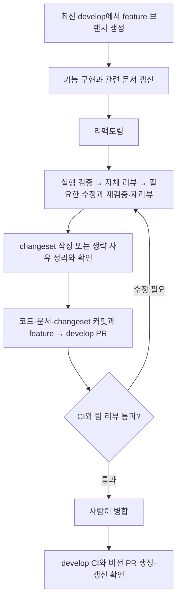
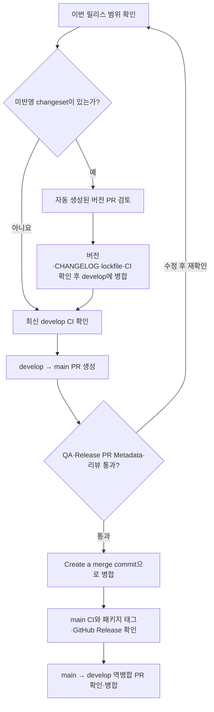

# 기능 개발과 패키지 릴리스

기능 담당자는 코드·관련 문서·changeset을 develop에 반영하고, 릴리스 담당자는 누적 변경의
버전을 확정해 main에 반영해요. 자동화는 패키지별 버전·CHANGELOG·GitHub 태그·Release를
관리하며, npm 게시나 서비스 배포는 수행하지 않아요.

## 기능 담당자: feature → develop



- [ ] 최신 develop을 기준으로 작업 브랜치를 만들어요.
- [ ] 구현과 함께 관련 문서를 갱신해요. 공유 UI 사용법은 [WOWDS README](../packages/wowds/README.md), 실행·구조는
      [루트 README](../README.md), 공통 작업 규칙은 [AGENTS.md](../AGENTS.md)를 확인해요.
- [ ] [공통 PR 준비 기준](../AGENTS.md#pr-준비와-리뷰)에 따라 리팩토링·검증·리뷰와 수정·재검증을 수행해요.
      정리할 코드가 없으면 리팩토링 생략 이유를 남겨요.
- [ ] `pnpm lint`, `pnpm typecheck`, `pnpm build`와 변경한 동작을 확인해요.
- [ ] 리뷰와 수정·재검증 후 확정된 코드 기준으로 changeset을 작성하거나 생략 사유를 준비해요.
      changeset 검사는 `pnpm changeset:check`, 계획 확인은 `pnpm changeset status --verbose`예요.
- [ ] 최종 변경 기준 PR 제목·본문을 작성하고, 검증 대상과 결과는 별도로 남겨요.
      `$gdg-pr-description`으로 제목·본문 작성을 요청할 수 있어요.
- [ ] 최종 코드·문서·changeset을 함께 커밋하고 feature → develop PR을 게시해요.
- [ ] feature → develop PR의 CI·리뷰와 changeset 또는 생략 사유를 확인하고 병합해요.
- [ ] develop CI와 버전 PR 생성·갱신 결과를 확인해요. 버전 PR 병합은 릴리스 담당자가 맡아요.

### Changeset 작성

저장소 루트에서 다음 명령을 실행하거나 [공유 스킬](ai-skills.md) `$gdg-changeset`에 작성을 요청해요.

```bash
pnpm changeset
```

1. 방향키로 패키지를 탐색하고 Space로 선택한 뒤 Enter를 눌러요.
2. major 대상을 선택하고, 이어서 minor 대상을 선택해요. 나머지 선택 패키지는 patch가 돼요.
3. 무엇이 바뀌었는지, 필요한 사용처 수정 방법을 입력해요. 본문은 CHANGELOG에 반영돼요.
4. 생성된 `.changeset/<임의의 이름>.md`를 확인하고 기능 코드와 같은 PR에 커밋해요.

| 대상           | 릴리스에 반영할 변경                        |
| -------------- | ------------------------------------------- |
| `@gdg/landing` | 랜딩 앱의 동작·화면·공개 콘텐츠             |
| `@gdg/wowds`   | 공유 UI·아이콘·토큰·폰트와 공개 API         |
| `@gdg/utils`   | 공통 HTTP 요청 유틸리티의 동작과 공개 API   |
| `@gdg/config`  | 소비 앱·패키지에 영향을 주는 공유 개발 설정 |

| 증가 종류 | 기준                                                           |
| --------- | -------------------------------------------------------------- |
| patch     | 기존 사용법과 호환되는 버그 수정                               |
| minor     | 기존 사용법을 유지하는 기능 추가                               |
| major     | 기존 props·export 제거처럼 소비 코드 수정이 필요한 호환성 파괴 |

예를 들어 모집 모달의 키보드 동작을 수정했다면 다음처럼 작성해요.

```markdown
---
'@gdg/landing': patch
---

모집 모달에서 Escape 키로 닫은 뒤, 모달을 열었던 버튼으로 포커스가 돌아오도록 수정했어요.
```

기존 changeset이 같은 변경을 설명하면 그 파일을 갱신하고 중복 생성하지 않아요.
여러 패키지를 직접 변경했다면 각 패키지와 증가 종류를 함께 적을 수 있어요.
의존성 전파로 생기는 추가 버전 증가는 CLI 결과와 버전 PR에서 확인해요.
설정상 런타임 의존성과 개발 의존성의 전파가 다르므로 앱의 버전 증가를 추정하지 않아요.

```bash
pnpm changeset:check
pnpm changeset status --verbose
```

문서 오탈자·PR 템플릿 등 릴리스에 영향이 없는 변경은 changeset을 생략하고 PR에 사유를 적어요.
예: `릴리스 도구와 팀 작업 안내만 변경했고 앱·공유 패키지 동작은 바뀌지 않아 생략했어요.`
공유 설정 변경을 모두 생략 대상으로 취급하지 말고 실제 소비 패키지 영향을 확인해요.

기능 담당자가 버전과 CHANGELOG를 직접 올릴 필요는 없어요. 버전 PR에서 누적 changeset을
반영하며, 같은 패키지의 여러 changeset은 가장 큰 증가 종류로 합쳐져요.
증가 종류는 소스 코드 diff와 사용처를 검토해 결정하며, CI 통과만으로 적절성이 보장되지 않아요.

## 릴리스 담당자: develop → main



- [ ] 릴리스에 포함할 기능과 알려진 문제를 확인해요.
- [ ] 미반영 changeset이 있으면 `changeset-release/develop` → `develop`의
      **[CHORE] version packages** PR이 최신 develop을 반영했는지 확인해요.
- [ ] 패키지별 버전·CHANGELOG·lockfile, 반영한 changeset 삭제와 소비 앱 영향을 확인해요.
- [ ] 버전 PR의 CI가 통과하면 develop에 병합해요.
- [ ] 최신 develop CI가 통과했고 미반영 changeset이 없는지 확인해요.
- [ ] develop → main PR을 만들고 자동 갱신된 제목과 릴리스 범위를 확인해요.
- [ ] `QA & Build Verification`, `Release PR Metadata`와 팀 리뷰가 최신 대상에 대해 통과했는지 확인해요.
      새 changeset이 추가되면 버전 PR 반영부터 다시 확인해요.
- [ ] **Create a merge commit**으로 main에 병합해요. 이 릴리스 경로는 squash/rebase 병합을 지원하지 않아요.
- [ ] main CI와 `Publish Package Releases`의 성공을 확인해요.
- [ ] `@gdg/landing@<version>` 등 패키지별 태그가 해당 버전을 반영한 main 병합 커밋을 가리키는지 확인해요.
- [ ] GitHub Release 설명이 해당 태그에 저장된 CHANGELOG의 버전 항목과 일치하는지 확인해요.
- [ ] main → develop 역병합 PR을 만들고 CI·리뷰 확인 후 병합해요.

`$gdg-release-check`는 위 항목을 읽기 전용으로 점검해 완료 항목과 남은 TODO를 정리해요.
로컬의 커밋된 두 ref를 검사할 때는 아래처럼 실행해요. 원격 최신 여부와 미커밋 제외 여부를 별도로 확인해요.

```bash
pnpm release:check origin/main origin/develop
```

버전 변경이 없는 릴리스 PR 제목은 `chore: sync develop to main`이에요.
`0.0.0` 패키지는 태그·Release를 만들지 않으며, 루트 패키지는 릴리스 대상이 아니에요.
릴리스 검사는 SemVer 기준 버전 하향과 잘못된 버전 형식을 거부해요.
코드를 되돌려야 해도 이미 발행한 버전보다 높은 새 버전으로 릴리스해요.

## 자동화와 수동 확인의 경계

| 실행 계기              | 자동 작업                                               | 사람이 확인할 것                            |
| ---------------------- | ------------------------------------------------------- | ------------------------------------------- |
| 기능 PR → develop      | QA, changeset 형식 검사, 새 changeset 누락 경고         | 증가 종류·설명 또는 생략 사유, 팀 리뷰·병합 |
| develop push + QA 성공 | 버전 PR 생성·갱신, 생성 브랜치의 CI 명시 실행           | 버전 PR 내용·CI, 릴리스 시점·병합           |
| develop → main PR      | 출발 브랜치·미반영 changeset·CHANGELOG 검사, 제목 갱신  | 최종 범위·검사·리뷰, merge commit 병합      |
| main push + QA 성공    | 릴리스 준비 검사, 패키지별 annotated tag·GitHub Release | 태그 대상·설명·실패 여부, 역병합            |

changeset 누락은 경고이며 병합 차단이 아니에요. 잘못된 형식·패키지 이름·증가 종류·빈 릴리스 설명은
실패해요. 버전 PR·릴리스 PR·역병합 PR에는 기능 changeset 누락 경고를 적용하지 않아요.
누적 changeset의 존재만으로 이번 기능 PR의 작성 완료를 판단하지 않아요.

기존 `sync` 작업은 QA 성공 뒤 main/develop을 별도 저장소로 강제 push해요. 버전 준비·태그 생성과
별개 작업이며, 태그·Release는 동기화하지 않아요. 수동 CI 실행에는 sync를 포함하지 않아요.
쓰기 작업은 원본 저장소 `gdg-hongik-univ/gdg-hongik`에서만 실행돼요.

### GitHub에서 한 번 설정할 것

아래는 파일 추가만으로 활성화되지 않는 저장소 설정이에요. 실제 적용 여부는 별도로 확인해야 해요.

- [ ] Actions → General의 **Allow GitHub Actions to create and approve pull requests**를 켜요.
      자동화는 PR을 생성하며 승인·병합은 수행하지 않아요. 별도 PAT를 추가하지 않고 `GITHUB_TOKEN`을 사용해요.
- [ ] 저장소에서 merge commit 병합을 허용해요.
- [ ] 검사가 한 번 실행된 뒤 main에 `QA & Build Verification`, `Release PR Metadata`를 필수 검사로 설정해요.
      [main ruleset 정의](../.github/main-release-ruleset.json)를 가져와 사용할 수 있어요.
      ruleset 지원 여부는 저장소 공개 범위·요금제에 따라 확인해요. 적용 전에는 사람이 검사 결과를 확인해요.
- [ ] 기존 sync용 secret과 대상 저장소 접근 권한을 확인해요. 값은 문서·코드에 기록하지 않아요.

### 실패 후 재실행

먼저 실패 원인을 확인하고 대상 브랜치의 최신 CI·변경 범위를 다시 확인해요.
`CI, Releases & Synchronization`의 **Run workflow**에서 다음과 같이 선택할 수 있어요.

| Branch                    | task            | 실행 범위                                |
| ------------------------- | --------------- | ---------------------------------------- |
| develop                   | prepare-version | QA 후 버전 PR 생성·갱신                  |
| changeset-release/develop | check           | 생성된 버전 브랜치 QA                    |
| main                      | tag-release     | QA·릴리스 준비 검사 후 태그·Release 생성 |

`check`는 QA만 실행해요. 버전·릴리스 작업은 지정된 브랜치에서만 실행돼요.
수동 `tag-release`에는 복구할 main 릴리스 병합 커밋의 전체 40자리 SHA를 `release_sha`에 입력해요.
main push의 자동 실행은 해당 push SHA를 사용해요. 수동 복구는 SHA가 없거나 체크아웃한 main의
first-parent 이력에 없는 커밋이면 실패하고, 지정한 커밋이 병합 커밋인지와 릴리스 준비 상태도 확인해요.
검사·태그·릴리스 노트는 모두 이 SHA의 패키지 버전과 CHANGELOG를 기준으로 처리해요.
실행 도구는 현재 워크플로 커밋의 코드를 사용하며, 과거 커밋으로 작업 트리를 바꾸지 않아요.

태그·Release 재실행은 기존 항목을 유지하고 지정한 릴리스에서 생성이 빠진 항목을 복구해요.
이후 같은 패키지가 새 버전으로 올라가거나 main에 일반 커밋이 추가돼도, 실패했던 릴리스의 SHA로 복구할 수 있어요.
기존 태그 대상의 패키지명·버전이 일치하지 않으면 push 전에 실패하며 태그를 자동으로 덮어쓰지 않아요.
main PR 검사·제목 갱신은 **Release PR → Run workflow**에서 기본 브랜치와 해당 PR 번호를 선택해요.
이 파일들이 기본 브랜치에 반영돼 있어야 수동 실행을 사용할 수 있어요.

릴리스 도구의 로컬 회귀 검증은 `pnpm test:release`예요. 테스트는 임시 Git 저장소와 로컬 bare remote를
사용하며 실제 GitHub로 push하지 않아요. 루트에서 `pnpm tag-packages`를 직접 실행하는 것은 원격 쓰기 작업이에요.

Changesets 사용법은 [공식 문서](https://github.com/changesets/changesets/tree/%40changesets/cli%402.31.1/docs),
참고 구현은 [mono-repo-test](https://github.com/soulchicken/mono-repo-test)예요.
